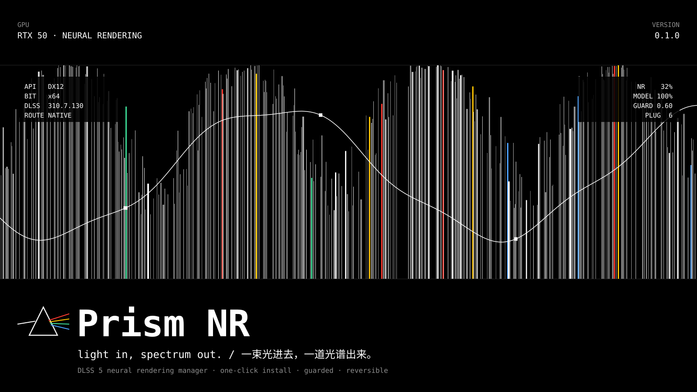
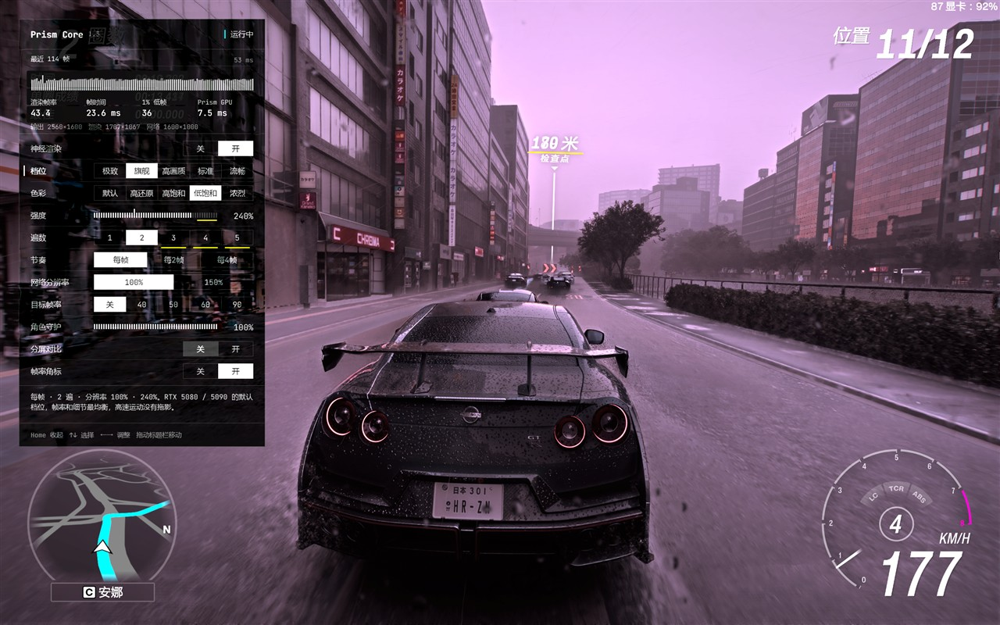
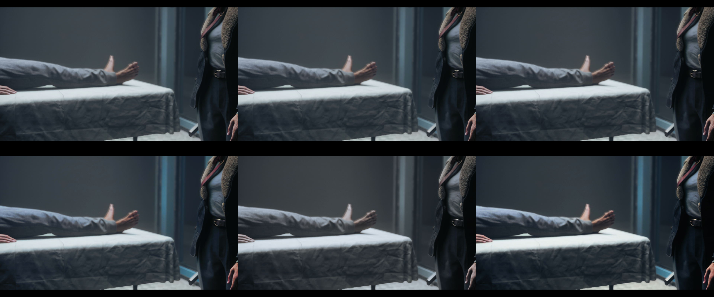

<div align="center">


# Prism NR

**Light in, spectrum out.**
A DLSS 5 neural rendering manager with its own runtime. One click, guarded, reversible.


[中文说明](README.zh-CN.md) ·
[Website](https://prism.chefzc.dev) ·
[Prism Core](native/prism-core/README.md) ·
[Changelog](CHANGELOG.md) ·
[Safety model](SECURITY.md) ·
[Design system](DESIGN.md)

</div>



Prism NR finds your games, reads each executable and brings in **Prism Core**, its own DLSS 5
neural rendering runtime: no ReShade, no OptiScaler, no RenoDX, nothing downloaded. Core runs
NVIDIA's signed network itself, keeps faces, shadows and highlights from being regenerated, and
can be tuned live from a panel inside the game. Every install is one transaction that rollback puts
back exactly as it was.



## New in 1.5

- **Accounts, optional.** Sign up with an email code; sign in by email, phone or username. A
  profile with an avatar, a bio, the founder's seal, the contributor's mark and a nameplate. Prism
  works exactly the same without signing in.
- **The community, by game.** 623 official looks for 206 games, new releases and classics, each
  game with a look of its own and two in styles that suit its genre. Search in Chinese, English or
  by nickname (地平线6, fh6, 大表哥, cp2077). Games in your library come first.
- **The game you are playing comes first**, and one press imports a look into it: the running game
  takes it within a second, no restart.
- **Grade codes.** The grading desk exports a look as one line of text (`PRISM1.…`) that carries
  the game it was made for and a checksum.
- **Two cards.** On laptops with integrated graphics and desktops with two cards, games are set to
  Windows' high-performance GPU and the network always runs on an NVIDIA card (choose which in
  Settings). *副卡运行* (Offload=) is experimental, see [what has been verified](#what-has-been-verified).
- **A mirror for mainland China** (account.chefzc.dev): both addresses are tried at start and the
  first to answer wins (52 ms average from mainland nodes, against 72 ms direct).
- **Redeem codes and plugin packs**, the groundwork for packs to come.
- **1.5.1:** avatar upload works in the installed app; updates never sign you out; no multi-second
  freeze when Prism first starts working (its preparation moved off the game's render thread:
  587 → 1608 frames presented in the first 8 s of a test app).

## Prism Core

| | |
|---|---|
| **Any game** | DX12 games with DLSS: Core takes over the game's own DLSS call (best image, lowest cost). DX12 without DLSS: present mode. DX9, DX10, DX11 and every 32-bit game: the frame bridge, through a 64-bit helper. The best path is picked by itself, DX12 first. |
| **Tiers** | 极致, 旗舰, 高画质, 标准, 流畅: how often the network runs, how many passes, at what resolution. Every setting can still be tuned by hand. |
| **In-game panel** | Home (View + Y on a gamepad): a frame-time barcode, rendered and displayed frame rates, 1% low and Prism's GPU time; every setting live; a split view; a target frame rate that steps the network's resolution down when the game falls short. Works on generated frames and in SDR, scRGB and HDR10. |
| **Colour looks** | 默认, 高还原, 高饱和, 低饱和, 浓烈, graded in scene light before the game's tone mapping; plus 自定义, a custom look with 66 controls on a grading desk in the game and in the app. |
| **Guards** | The character guard keeps the network from recolouring skin and hair; hair and fine detail keep their contrast; every-frame tiers carry nothing over, so fast motion leaves no trails. |
| **Plays well with others** | ReShade and OptiScaler stay installed. Denuvo games load Core late, on the first press of Home, without touching the game or the protection. |

Forza Horizon 6 benchmark, RTX 5090 Laptop, 2560×1600, DLSS Quality, 2× frame generation, same
session: **Prism 旗舰 87 FPS, 极致 77 FPS, RenoDX DLSS 5 8.5 67 FPS**. Same two network passes per
frame; 旗舰 is about 30% faster. How Core works and every setting: [native/prism-core](native/prism-core/README.md).



## Download

[**PrismNR-1.5.1-x64-setup.exe**](https://github.com/ChefDavid0815/prism-nr/releases/tag/v1.5.1) · Windows 10 / 11 x64 · per-user install, no admin rights needed. Installing over an older version keeps your sign-in, settings and enabled games.

[**PrismCore-1.5.1-win64.zip**](https://github.com/ChefDavid0815/prism-nr/releases/tag/v1.5.1) · the Prism Core runtime on its own, for installing by hand as described in [native/prism-core](native/prism-core/README.md).

Newer builds are on the website: [prism.chefzc.dev](https://prism.chefzc.dev).

The installer is not code-signed yet, so Windows SmartScreen may warn on first run: choose *More info → Run anyway*.

**Needs:** an NVIDIA RTX 50 series GPU, Windows 10 or 11, 64-bit. Games with anti-cheat are refused: do not use injection mods in online games.

## Build from source

Requirements: Windows 10 / 11, Node.js 20+, an RTX 50 GPU for neural rendering. Prism Core builds
with MinGW-w64 g++ (`native/prism-core/build.sh`).

```bash
npm install
npm run dev        # Vite + Electron with live reload
npm run build      # type-check and production build
npm run test:core  # read-only self-test against this PC: GPU, scan, analysis, plans
```

## What has been verified

- Accounts, the community, grade codes and redeem codes run against the real server: sign-up with
  the email code, the three ways to sign in, sharing and importing, redeeming and every way a code
  can be refused.
- Prism Core in games on an RTX 5090 Laptop: CONTROL Resonant and Forza Horizon 6 (with 2× frame
  generation); Denuvo late loading in Crimson Desert.
- The frame bridge (DX9 and DX11, 32 and 64-bit) end to end with test programs through the real
  helper and network; not yet in a game.
- *副卡运行* (Offload=): the whole path works and the picture is identical to one card, but every
  frame crosses system memory between the cards and waits for it. On one machine that added about
  18 ms per frame at 3.9 megapixels, so it is slower than one card there; it stays experimental and
  off by default. Not yet tested with two RTX cards.

## Credits and license

Prism NR is MIT-licensed open source. It is not an NVIDIA product and is not affiliated with
NVIDIA; DLSS is an NVIDIA trademark. The installer ships NVIDIA's signed DLSS neural rendering
runtime (`nvngx_dlssnr.dll`) unmodified; it remains NVIDIA's software under NVIDIA's terms. Prism
Core contains no NVIDIA code; interface details come from RenoDX DLSS5 (MIT) and neural-upstream
(MIT). [MinHook](https://github.com/TsudaKageyu/minhook) is BSD-2-Clause; JetBrains Mono is SIL OFL
1.1. Versions before 1.2 installed ReShade, OptiScaler, DLSS5-Feeder, RenoDX and LumeniteFX from
their own releases; none of them ships or is downloaded any more.
