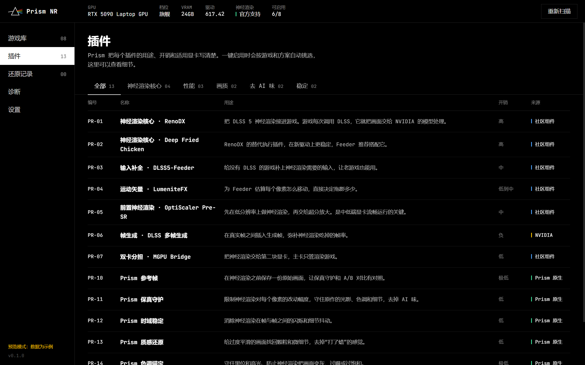
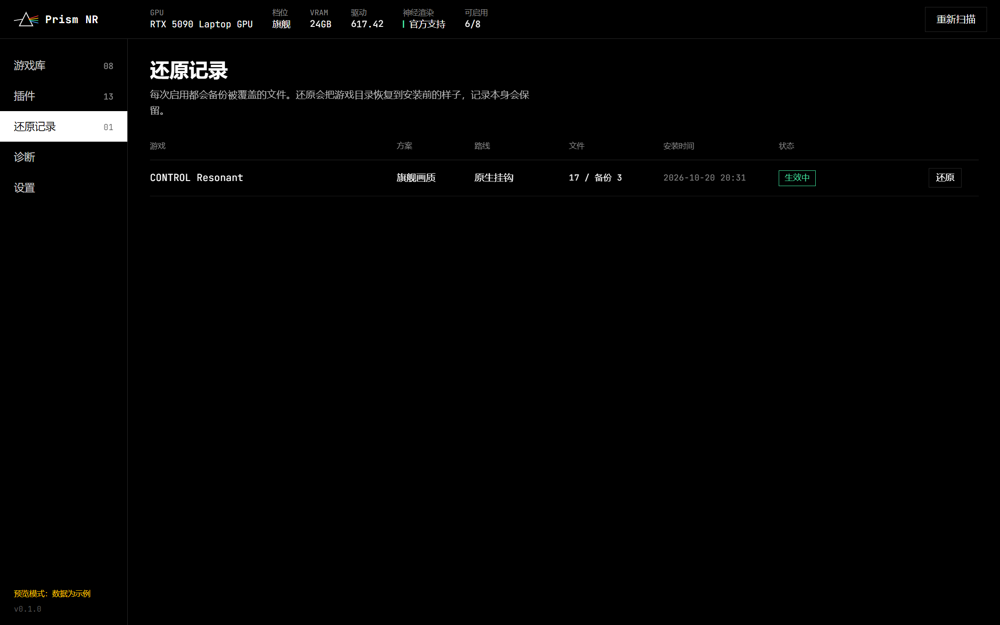
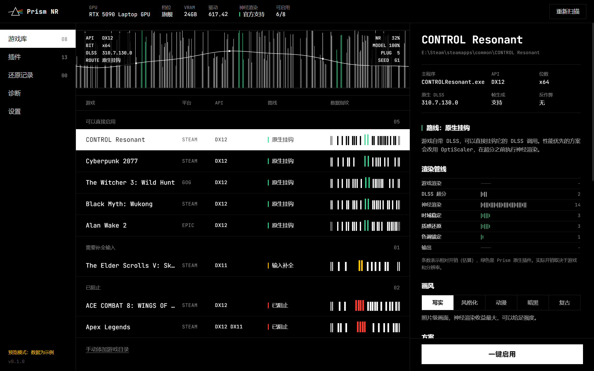

<div align="center">


# Prism NR

**一束光进去，一道光谱出来。**
DLSS 5 神经渲染管理器。一键安装，有守护，可还原。


[English](README.md) ·
[安全模型](SECURITY.md) ·
[更新日志](CHANGELOG.md) ·
[设计系统](DESIGN.md)

</div>


社区的 DLSS 5 插件能用，但要跑起来，得自己在 ReShade 插件、OptiScaler 分支、Feeder 之间做选择，复制对的 DLL，对上驱动版本，改预处理宏；跑起来之后，还要忍受被"重新生成"的人脸、被提亮的暗部，以及一起被神经渲染处理的 UI。**Prism NR 替你做完这些事。** 它找到你的游戏，读每个游戏的主程序，选合适的路线，从开源组件的官方发布页下载并校验，在一次事务里装好全部文件，也能把游戏目录原样还原。它自带的着色器插件让神经渲染只做增强，不做替换。

## 它能做什么

| | |
|---|---|
| **扫描游戏库** | 读取 Steam（`libraryfolders.vdf` 和应用清单）、Epic 清单、GOG 注册表、Xbox 的 `MicrosoftGame.config`。商店工具、运行库和无关文件夹会被过滤掉。 |
| **分析主程序** | 解析 PE 文件头，包括延迟加载导入表和旁边的渲染器 DLL，识别 DX9 到 DX12、Vulkan、OpenGL；读取位数、原生 DLSS 及版本、Streamline、帧生成和其他超分。 |
| **自动选路线** | 游戏自带 DLSS 时走**原生挂钩**；需要性能时走 **OptiScaler 前置**（神经渲染在超分之前、在更小的画面上执行）；没有 DLSS 的游戏走 **Feeder**。Prism 替你选，并说明原因。 |
| **拦截反作弊** | 从磁盘文件识别 Easy Anti-Cheat、BattlEye、EA Javelin、HoYoProtect、腾讯 ACE、GameGuard、XIGNCODE3、PunkBuster、Vanguard、网易保护。这些游戏直接拒绝安装，而不只是提醒。 |
| **一键安装** | 从各自的发布渠道获取 ReShade、OptiScaler DLSS-NR、DLSS5-Feeder 和 RenoDX 插件，按 GitHub 公布的 SHA-256 校验，写好 `ReShade.ini`、方案文件、效果顺序和全部参数，再记下安装清单。中途失败会撤回已经写入的文件。 |
| **NVIDIA 文件只用你自己的** | Prism 不下载也不分发 NVIDIA 的文件。它在你电脑上找 `nvngx_dlssnr.dll` 和 `nvngx_dlss.dll`，校验数字签名，优先使用 NVIDIA 签名版，只有未签名版时会明确告诉你。 |
| **方案和画风** | 按显卡档位的四套方案（旗舰画质、均衡、流畅优先、原片优先）和五种画风（写实、风格化、动漫、暗黑、复古），另有 17 个游戏的推荐配置和社区注意事项。 |
| **还原** | 每个被覆盖的文件都有备份。还原会恢复游戏目录，标出你在安装后改过的文件，记录保留并盖上"已还原"。 |
| **诊断** | 显卡档位和效果预期、NGX 文件和签名状态、日志，以及可以分享的 JSON 报告。 |

<table>
<tr>
<td width="50%"></td>
<td width="50%"></td>
</tr>
</table>



<sub>截图使用软件的预览数据，不是真实扫描结果。</sub>

## Prism 原生插件

为这个项目编写的五个着色器（ReShade FX，自包含，MIT 协议）：

| 编号 | 插件 | 用途 |
|---|---|---|
| PR-10 | **参考帧** | 在神经渲染之前保存原始画面，让其他插件有对照。 |
| PR-11 | **保真守护** | 柔性限制每个像素的亮度和颜色能被改多少，用频率分离把原片丢失的细节加回来，阻止暗部被提亮，框选的 UI 区域保持原样。目前需要 Feeder 路线。 |
| PR-12 | **时域稳定** | 用按邻域裁剪的历史帧消除帧间闪烁，运动时不拖影。 |
| PR-13 | **质感还原** | 对比度自适应的微细节和按亮度分配的颗粒，去掉"打了蜡"的感觉。 |
| PR-14 | **色调锚定** | 黑位曲线、高光压缩和饱和度护栏，工作空间同时支持 scRGB HDR。 |
| PR-15 | **A/B 对比** | 参考帧和最终画面分屏对比。 |

社区和 NVIDIA 组件也在同一个插件中心里，写明编号、开销、适用显卡和来源：RenoDX DLSS 5 插件、Deep Fried Chicken、DLSS5-Feeder、LumeniteFX、OptiScaler DLSS-NR Pre-SR、DLSS 多帧生成、MGPU Bridge。

## 方案

| 方案 | 适用 | 改动 | 预期 |
|---|---|---|---|
| **旗舰画质** | RTX 5080 / 5090 / 5090 Laptop | 超分后完整执行神经渲染，配齐 Prism 插件 | 画质最好。4K 下神经渲染本身可能吃掉接近一半帧率。 |
| **均衡** | RTX 5070 Ti / 5080 Laptop | Pre-SR，模型分辨率 67%，2× 帧生成 | 接近旗舰；社区测试中损失降到约四分之一到三分之一。 |
| **流畅优先** | RTX 5060 / 5070 | Pre-SR 50%，3× 帧生成，加强质感还原 | 靠帧生成，显示帧率常常高于不开时。基础帧率和延迟仍有代价，不是零损失。 |
| **原片优先** | 任意 RTX 50 | 低强度，严格守护 | 光照质感提升，人脸和美术风格不变。 |

## 下载

[**PrismNR-0.1.0-x64-setup.exe**](https://github.com/ChefDavid0815/prism-nr/releases/latest) · Windows 10/11 x64 · 安装到当前用户，不需要管理员权限。

安装包暂未做代码签名，首次运行时 Windows SmartScreen 可能会拦截：点“更多信息 → 仍要运行”。安装包的 SHA-256 写在发布页上。

## 从源码构建

需要 Windows 11、Node.js 20 以上；神经渲染需要 RTX 50 显卡。

```bash
npm install
npm run dev        # Vite + Electron，实时刷新
npm run build      # 类型检查和生产构建
npm run test:core  # 只读自测：显卡、扫描、分析、安装方案
```

## 已验证的内容

- 类型检查和生产构建通过。
- 自测在 RTX 5090 Laptop（驱动 617.42，Windows build 26300）上运行：显卡分档、Steam 和 Epic 扫描、PE 分析（包括延迟加载的 DX12）、反作弊识别、NGX 文件查找和签名校验。
- Electron 桌面版连接真实后端运行；界面在 1440 × 900 和 1120 × 720 下检查过。

- 在 CONTROL Resonant（DX12，原生挂钩路线）上完整安装：ReShade 6.8.0 和 RenoDX DLSS5 插件 6.5.3 从线上下载并校验，本机 NVIDIA 签名版 DLSSNR 310.8 运行库初始化成功，6 个 Prism 着色器在 ReShade 中全部编译通过、没有警告。还原后游戏目录恢复原样。
- 同一台机器实测（2560 × 1600、极致画质、光追极致、帧生成 2×）：同样的游戏设置下，Prism 方案比 RenoDX 默认在 DLSS 质量档快 8%、性能档快 13%；旗舰方案多跑三个画质插件，在 DLAA 下比 RenoDX 慢 2.5%。

尚未验证：OptiScaler 和 DLSS5-Feeder 路线在真实游戏中的表现，以及 RTX 5090 Laptop 以外的显卡。

## 致谢与许可证

Prism NR 是 MIT 协议的开源软件。它不是 NVIDIA 产品，与 NVIDIA 没有关联；DLSS 是 NVIDIA 的商标。它依赖 [ReShade](https://reshade.me)（BSD-3-Clause）、[OptiScaler DLSS-NR](https://github.com/Dagherbou/OptiScaler_DLSSNR) 和 [Pre-SR Multipass](https://github.com/wilsjo2/OptiScaler-DLSSNR-PreSR-Multipass)（GPL-3.0）、[DLSS5-Feeder](https://github.com/jlrouzies-fr/DLSS5-Feeder)、[RenoDX](https://github.com/RankFTW/rhi-repo)，各自遵循自己的许可证。不要在网络游戏中使用注入类 Mod。
